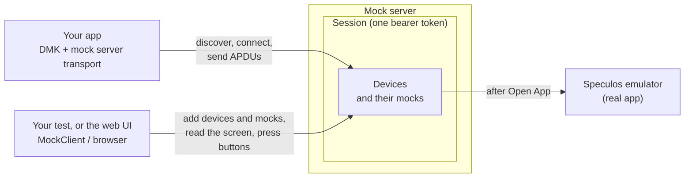

# Device Mock Server

An HTTP server that emulates Ledger devices for apps built on the [Device Management Kit](https://github.com/LedgerHQ/device-sdk-ts) (DMK). Your app connects to a fake device through the mock server transport, and your tests (or you, in a web UI) decide what the device answers. You can use it for automated tests and for manual testing without a physical device.

The server can:

- attach fake devices with the model, firmware and apps you choose,
- answer the standard APDUs from that metadata, so a device works with no setup,
- return your own responses for any APDU (**mocks**), to force errors and edge cases,
- run genuine check and app install/list/uninstall offline, with no HSM,
- run a real app in a [Speculos](https://github.com/LedgerHQ/speculos) emulator when the app is opened, and let you read its screen and press its buttons.

This README is for people who **use** the server. To work on the server itself, read [`doc/architecture.md`](./doc/architecture.md).

## 🔹 Index

1. [How it works](#-how-it-works)
2. [Where to run it](#-where-to-run-it)
3. [Connect a DMK app](#-connect-a-dmk-app)
4. [Control the session with `MockClient`](#-control-the-session-with-mockclient)
5. [What a device does with no mocks](#-what-a-device-does-with-no-mocks)
6. [Mocks](#-mocks)
7. [Run real apps on Speculos](#-run-real-apps-on-speculos)
8. [Automated tests](#-automated-tests)
9. [Manual tests](#-manual-tests)
10. [Troubleshooting](#-troubleshooting)
11. [Limits](#-limits)
12. [HTTP API](#-http-api)

## 🔹 How it works



- **Session.** Everything lives in a session. `POST /auth` creates one and returns a **bearer token**. Every client that uses the same token sees the same devices. Your app and your test must use the **same token**.
- **Device.** A fake device in the session: model, firmware, installed apps, connected or not. Your app discovers it like a USB device.
- **Mock.** A rule on one device: "when an APDU starts with this prefix, answer this". Mocks always win over the default answers.
- **Speculos.** When your app opens an app that is installed on the device, the server can start a Speculos emulator and send the next APDUs to it. You then get the real app's answers and screens.

Sessions expire after **30 minutes** with no request, and after **4 hours** in all. The server keeps everything in memory: a restart deletes all sessions.

## 🔹 Where to run it

### Hosted instance

Ledger hosts an instance at **<https://device-mock-server.aws.ldg-ps-default.ldg-tech.com>**. You can reach it only on the **Ledger VPN**.

- Open the URL in a browser to get the web UI (see [Manual tests](#-manual-tests)).
- Speculos is enabled on it.
- It is DMK's default `mockUrl`, so the transport uses it when you give no URL.
- Other people use it at the same time. Each session is private to its token, so this has no effect on your devices.

### Run it locally

Install the dependencies from the monorepo root, then start the server:

```bash
pnpm install
pnpm --filter @ledgerhq/device-mock-server serve   # http://127.0.0.1:9752
```

`serve` builds the web UI first, so <http://127.0.0.1:9752> shows it. `dev` does the same and restarts on each change. To check that the server is up:

```bash
curl http://127.0.0.1:9752/health
# {"status":"ok","sessions":0}
```

Or with Docker (the build context is the monorepo root, `docker compose` handles that):

```bash
cd apps/device-mock-server
docker compose up --build                      # with Speculos
SPECULINHO_URL= docker compose up --build      # pure mock, fully offline
```

Copy `.env.example` to `.env` to keep your settings. The server reads these variables:

| Variable                    | Default                             | Description                                                                                                     |
| --------------------------- | ----------------------------------- | --------------------------------------------------------------------------------------------------------------- |
| `PORT`                      | `9752`                              | HTTP port.                                                                                                      |
| `SPECULINHO_URL`            | `https://speculinho.ledgerlabs.net` | Service that starts the Speculos emulators. Set it to empty (`SPECULINHO_URL=`) to run with no Speculos.        |
| `SPECULOS_VERSION`          | _unset_                             | Pin a Speculos version.                                                                                         |
| `SPECULOS_READY_TIMEOUT_MS` | `120000`                            | How long to wait for an emulator to start.                                                                      |
| `MOCK_SERVER_LOG_LEVEL`     | `info`                              | One of `silent`, `error`, `warn`, `info`, `debug`.                                                              |
| `MOCK_SERVER_WEB_DIR`       | _auto-detected_                     | Directory of the built web UI. See [`doc/architecture.md`](./doc/architecture.md#-web-ui) for the lookup order. |

### Run it in your test process

Inside this monorepo, tests can start the server in the test process itself, on a random free port. The package is private, so this works only here:

```ts
import { createMockServer } from "@ledgerhq/device-mock-server";

const { app, close, attachWebSocket } = createMockServer({
  sweepIntervalMs: 0,
});
const server = app.listen(0); // random free port
attachWebSocket(server); // only needed for genuine check and app management

// ... run your tests against `http://127.0.0.1:${server.address().port}`, then:
server.close();
close();
```

With no `speculos` option, this server runs with no Speculos. The options are listed in [`doc/architecture.md`](./doc/architecture.md#createmockserver-options).

## 🔹 Connect a DMK app

Install the transport and the client:

```bash
pnpm add @ledgerhq/device-transport-kit-mockserver @ledgerhq/device-mockserver-client
```

Create a session, then give its token to DMK in two places:

```ts
import { DeviceManagementKitBuilder } from "@ledgerhq/device-management-kit";
import { MockClient } from "@ledgerhq/device-mockserver-client";
import {
  mockserverIdentifier,
  mockserverTransportFactory,
} from "@ledgerhq/device-transport-kit-mockserver";

const MOCK_SERVER_URL = "http://127.0.0.1:9752";

const mockClient = new MockClient(MOCK_SERVER_URL);
const token = await mockClient.authenticate();

const dmk = new DeviceManagementKitBuilder()
  .addTransport(mockserverTransportFactory(MOCK_SERVER_URL, token))
  .addConfig({
    mockUrl: MOCK_SERVER_URL,
    webSocketUrl: `ws://127.0.0.1:9752/secure-channel/${token}`,
  })
  .build();
```

**1. The token in the transport.** Without a token, the transport creates its own session. Your test or the web UI cannot find that token, so it cannot add devices or mocks to that session.

**2. The token in `webSocketUrl`.**

- **Problem:** genuine check, list apps, install and uninstall apps, and firmware update get their APDUs from Ledger's secure-channel backend, over a WebSocket at DMK's `webSocketUrl`. With the default `webSocketUrl`, they connect to the real backend, which cannot work with a mock device.
- **Solution:** set `webSocketUrl` to the mock server's own WebSocket, `ws(s)://<host>/secure-channel/<token>`. Use `wss://` for an `https://` server. The token goes in the path because a browser WebSocket cannot send an `Authorization` header.

Then discover and connect as with any transport:

```ts
import { firstValueFrom } from "rxjs";

const device = await mockClient.addDevice({ device_type: "stax" });

const discovered = await firstValueFrom(
  dmk.startDiscovering({ transport: mockserverIdentifier }),
);
const sessionId = await dmk.connect({ device: discovered });
```

`dmk.connect()` also marks the device as connected on the server.

The transport asks the server for its devices every second. A device you add appears in the next second. When you delete or disconnect a device through the API, DMK gets a disconnect event in the next second too, as if you unplugged a real device.

The [sample app](../sample/src/providers/DeviceManagementKitProvider/transportConfig.ts) does the same setup from its settings.

### Show the device screen in your app

- [`@ledgerhq/device-mockserver-react`](../../packages/mockserver-device-react) and [`@ledgerhq/device-mockserver-react-native`](../../packages/mockserver-device-react-native) render a device's live screen with its buttons. They need the URL, the token and the device id.
- [DMK DevTools](../../packages/devtools/core/README.md#mock-server) shows the same screen and opens the web UI on your session. Give the URL and token to `DevToolsDmkInspector`.

## 🔹 Control the session with `MockClient`

[`@ledgerhq/device-mockserver-client`](../../packages/mockserver-client) is the typed client for the HTTP API. Give it a token to join a session, or let it create one on its first call:

```ts
const joined = new MockClient(url, { token }); // join an existing session
const fresh = new MockClient(url, { timeoutMs: 10_000 }); // creates a session on first call
const token = await fresh.authenticate(); // or create it now and read the token
```

| Area       | Methods                                                                                                  |
| ---------- | -------------------------------------------------------------------------------------------------------- |
| Server     | `getHealth()`                                                                                            |
| Session    | `authenticate()`, `getToken()`, `getSession()`, `disposeSession()`, `exportSession()`, `importSession()` |
| Devices    | `listDevices()`, `addDevice()`, `getDevice()`, `editDevice()`, `deleteDevice()`                          |
| Connection | `connect()`, `disconnect()`, `disconnectAll()`                                                           |
| Mocks      | `listMocks()`, `addMock()`, `editMock()`, `deleteMock()`, `clearMocks()`                                 |
| APDU       | `sendApdu()`: send an APDU yourself, as DMK would                                                        |
| Speculos   | `setSeed()`, `getSpeculos()`, `getScreenshot()`, `pressButton()`, `touchScreen()`                        |

### Device fields

`addDevice()` and `editDevice()` take a `DeviceConfig`. Every field is optional. `editDevice()` keeps the device id and changes only the fields you send.

| Field               | Default            | Description                                                                                                                                                                                     |
| ------------------- | ------------------ | ----------------------------------------------------------------------------------------------------------------------------------------------------------------------------------------------- |
| `device_type`       | `nanoX`            | `nanoS`, `nanoSP`, `nanoX`, `stax`, `flex` or `apexp`.                                                                                                                                          |
| `name`              | `Ledger Nano X`    | Device name.                                                                                                                                                                                    |
| `firmware_version`  | `2.2.3`            | OS version reported to DMK.                                                                                                                                                                     |
| `apps`              | `BOLOS 1.4.0` only | Installed apps, `{ name, version }`. List `BOLOS` first. An app must be in this list to open.                                                                                                   |
| `connectivity_type` | `USB`              | `USB` or `BLE`.                                                                                                                                                                                 |
| `masks`             | `[0x33000000]`     | Target id masks of the model.                                                                                                                                                                   |
| `onboarded`         | `true`             | `false` starts a device that is not set up and goes through the onboarding steps.                                                                                                               |
| `language`          | _English_          | Installed language pack, by name (`"french"`, `"german"`, …).                                                                                                                                   |
| `mocks`             | none               | Mocks to add with the device.                                                                                                                                                                   |
| `catalog`           | none               | Apps the install flow knows, `{ hash, name, version }`. The install flow finds the app from the hash DMK sends: first in `catalog`, then on the Manager API. Use it for tests that run offline. |

To find a firmware version and app versions that exist for a model, build the device in the [web UI](#-manual-tests): it asks the Manager API. Then export the session to get the JSON.

## 🔹 What a device does with no mocks

A new device answers these APDUs from its metadata. You do not need mocks for them:

| APDU or flow                                | Answer                                                                                                                                                        |
| ------------------------------------------- | ------------------------------------------------------------------------------------------------------------------------------------------------------------- |
| `GetOsVersion`, `GetAppAndVersion`          | Built from the device metadata (`device_type`, `firmware_version`, `language`) and the open app.                                                              |
| Genuine check                               | Genuine.                                                                                                                                                      |
| List apps                                   | The device's `apps`.                                                                                                                                          |
| Install and uninstall an app                | Success. After the last block, the app is added to or removed from the device's `apps`.                                                                       |
| Firmware update                             | Success. After the last block, the device reports the new `firmware_version`.                                                                                 |
| `SetDeviceName`                             | Renames the device. `GetDeviceName`, the device list and the export show the new name.                                                                        |
| Language pack list, install, delete         | Reads, sets and clears `language`.                                                                                                                            |
| Onboarding (device with `onboarded: false`) | Goes through the onboarding steps, then the device is onboarded.                                                                                              |
| `OpenApp`                                   | Starts Speculos for an app in `apps` (see [Speculos](#-run-real-apps-on-speculos)). `6807` if the app is not in `apps`. `6d00` if the server has no Speculos. |
| `CloseApp` (app open on Speculos)           | Stops Speculos. The device is back on the dashboard.                                                                                                          |
| Any other APDU (no app open)                | `6d00`.                                                                                                                                                       |

On a server with no Speculos, you can fake an open app with mocks: answer `OpenApp` (`e0d8`) with `9000`, and `GetAppAndVersion` (`b0010000`) with the app's name and version.

## 🔹 Mocks

A mock has a hex `prefix` and one or more hex responses. Each response is the data followed by the 2-byte status word: `9000` is success, `cafe9000` is data `cafe` with success, `5515` is "device locked".

```ts
// One response:
await mockClient.addMock(device.id, { prefix: "b0010000", response: "5515" });

// A sequence: one entry per matching APDU, then it starts again from the first.
await mockClient.addMock(device.id, {
  prefix: "e0f0",
  responses: ["9000", "9000", "9000", "9000", "6a84"],
});
```

Rules:

- A mock matches every APDU that **starts with** its prefix.
- When several mocks match, the **longest prefix** wins. With the same length, the **newest** wins.
- A mock **always wins**: over the default answers, and over Speculos while an app is open.
- Delete a mock to get the default answer back.
- Mocks belong to one device. Other devices in the session do not see them.

### Common error cases

| Case                                    | Mock                                                |
| --------------------------------------- | --------------------------------------------------- |
| Device locked                           | `b0010000` (`GetAppAndVersion`) → `5515`            |
| App not installed                       | `e0d8` (`OpenApp`) → `6807`                         |
| Unknown command                         | the command's prefix → `6d00`                       |
| User refuses the secure channel         | `e051` → `5501` or `6985`                           |
| Device locked during the secure channel | `e051` → `5515` or `6982`                           |
| Genuine check: certificate failure      | `e052` → `6d00`                                     |
| Install: not enough memory              | `e0f0` → `6a84`                                     |
| Install: app already installed          | `e0f0` → `6a80`                                     |
| Install: fail on the 5th block          | `e0f0` → `["9000", "9000", "9000", "9000", "6a84"]` |

DMK reads the status word, returns the matching error and stops the operation.

## 🔹 Run real apps on Speculos

When your app opens an app that is in the device's `apps` (with `OpenAppCommand`, a signer, or a device action), a server with Speculos starts an emulator for it. All the next APDUs go to the emulator, except the ones a mock catches. `CloseApp`, or quitting the app on the device screen, stops the emulator and the device goes back to the default answers.

Things to know:

- **Start-up is slow.** An emulator can take a minute or more to start. Give that step a long timeout (the sample app's tests use 90 to 120 seconds).
- **Use the exact app name**, as the device shows it: `Ethereum`, not `eth`.
- **Use an app version made for the firmware.** Speculos cannot run an app built for another OS version. The web UI's app picker lists only the versions available for the firmware you set.
- **Seed.** Each session starts with the Speculos test mnemonic `glory promote mansion idle axis finger extend february uncover one trip resolve toe`. To use another one, call `setSeed()` before your app opens the app. The server keeps the seed in plain text: **use test mnemonics only.**

### Script the device screen

Use `MockClient` to wait for the emulator, then read the screen and press buttons:

```ts
// getSpeculos() fails with 409 until the emulator is ready.
async function waitForSpeculos(deviceId: string, timeoutMs = 120_000) {
  const deadline = Date.now() + timeoutMs;
  for (;;) {
    try {
      return await mockClient.getSpeculos(deviceId);
    } catch (error) {
      if (Date.now() > deadline) throw error;
      await new Promise((resolve) => setTimeout(resolve, 1_000));
    }
  }
}

await waitForSpeculos(device.id);

// Nano S Plus, Nano X: buttons.
await mockClient.pressButton(device.id, "right");
await mockClient.pressButton(device.id, "both"); // confirm

// Stax, Flex, Apex: taps, in device screen pixels (Stax is 400 × 672).
// Take x and y from a screenshot of the screen you want to tap.
await mockClient.touchScreen(device.id, x, y);

// Hold to sign: press, wait, release.
await mockClient.touchScreen(device.id, x, y, "press");
await new Promise((resolve) => setTimeout(resolve, 5_000));
await mockClient.touchScreen(device.id, x, y, "release");

// The current screen as a PNG Blob, for a test report.
const png = await mockClient.getScreenshot(device.id);
```

`MockClient` covers the screenshot, the buttons and the touch screen. For the rest of the [Speculos REST API](https://github.com/LedgerHQ/speculos), send the request to `/devices/:id/speculos/<speculos path>` with your bearer token. The server sends it to the device's emulator. For example, to read the text on the current screen:

```bash
curl -H "Authorization: Bearer $TOKEN" \
  "$URL/devices/$DEVICE_ID/speculos/events?currentscreenonly=true"
```

These calls return `409` when no app is open.

## 🔹 Automated tests

For each test:

1. Create a session (`authenticate()`).
2. Add the devices and mocks the test needs.
3. Start your app or DMK with the server URL and the session token.
4. Run the test. Change mocks or press buttons while it runs, if needed.
5. Delete the session (`disposeSession()`), even when the test fails.

One session per test keeps tests independent: they can run in parallel on the same server.

```ts
import { DeviceManagementKit } from "@ledgerhq/device-management-kit";
import { MockClient } from "@ledgerhq/device-mockserver-client";

const MOCK_SERVER_URL = process.env.MOCK_SERVER_URL ?? "http://127.0.0.1:9752";

let mockClient: MockClient;
let dmk: DeviceManagementKit;

beforeAll(async () => {
  // Fail fast with a clear message when the server is not running.
  await new MockClient(MOCK_SERVER_URL, { timeoutMs: 5_000 }).getHealth();
});

beforeEach(async () => {
  mockClient = new MockClient(MOCK_SERVER_URL, { timeoutMs: 10_000 });
  const token = await mockClient.authenticate();
  dmk = buildDmk(MOCK_SERVER_URL, token); // see "Connect a DMK app"
});

afterEach(async () => {
  dmk.close();
  await mockClient.disposeSession();
});

it("reports a locked device", async () => {
  const device = await mockClient.addDevice({ device_type: "stax" });
  await mockClient.addMock(device.id, { prefix: "b0010000", response: "5515" });

  // connect DMK, send GetAppAndVersionCommand, expect a DeviceLockedError
});
```

**Load a session from a file.** Build a session once in the web UI, export it to JSON, and keep the file next to your tests. Then call `importSession(snapshot)` in the test. It replaces all the devices and mocks of the session.

**Full example.** The [sample app's Playwright suite](../sample/playwright) uses this pattern. Its [`mockClient` fixture](../sample/playwright/fixtures.ts) creates the session, gives the token to the app before the page loads and deletes the session after the test. Its [`SpeculosDriver`](../sample/playwright/utils/drivers/SpeculosDriver.ts) goes through a signing screen by screen.

## 🔹 Manual tests

1. Open the web UI: the [hosted instance](#hosted-instance) on the VPN, or <http://127.0.0.1:9752> for a [local server](#run-it-locally).
2. Create a session.
3. Add a device. The UI checks that the firmware exists for the model and lists the apps available for it.
4. Give the **server URL** and **token** shown in the UI to your app:
   - **DMK sample app:** in Settings, choose the mock server transport, then fill in _Mock Server URL_ and _Mock Server Session Token_.
   - **Ledger Wallet:** scan the QR code (mobile) or open the link (desktop). Both contain a `ledgerlive://mockserver/config` deep link.
   - **Your app:** set up the transport as in [Connect a DMK app](#-connect-a-dmk-app).
5. Connect from your app.
6. While you test, change the device or its mocks in the UI. The **ready-made scenarios** add the common mocks (device locked, app not installed, user refusal) in one click. **Interact** opens the device screen when an app runs on Speculos.
7. **Export** the session to JSON to share it or to start from it again later. **Import** loads it back. You can also paste the token of a session already in use, for example your app's, to join it.

### With an AI agent

This repo has a [`mock-server` agent skill](../../agent-files/skills/mock-server/SKILL.md) for Claude Code and Cursor. When you mention the mock server in a chat opened in this repo, the agent loads it and drives the server with `curl`: it adds devices, changes their firmware or apps, adds mocks, sends APDUs and taps the Speculos screen.

The skill uses a local server (`http://127.0.0.1:9752`) by default. For the hosted instance or your app's session, give the agent the URL and the **full** token. Your app's logs show only the first characters of the token.

## 🔹 Troubleshooting

| Problem                                                              | Cause and fix                                                                                                                                                                                                                                |
| -------------------------------------------------------------------- | -------------------------------------------------------------------------------------------------------------------------------------------------------------------------------------------------------------------------------------------- |
| The hosted instance does not answer.                                 | You are not on the Ledger VPN.                                                                                                                                                                                                               |
| The device does not appear in your app.                              | Your app and your test use different sessions. Give the same token to the transport and to `MockClient`. A transport with no token creates its own session.                                                                                  |
| Genuine check, list apps or install fails.                           | `webSocketUrl` is not set, so DMK connects to the real secure-channel backend. Set it to `ws(s)://<host>/secure-channel/<token>` (see [Connect a DMK app](#-connect-a-dmk-app)).                                                             |
| Calls fail with `401 Invalid or expired session`.                    | The session expired (30 minutes with no request, or 4 hours in all), or the server restarted. Create a new session.                                                                                                                          |
| Your app disconnects from the device.                                | A client of the session deleted or disconnected the device, or an APDU request to the server failed (server down, session expired).                                                                                                          |
| A mock has no effect.                                                | The mock is on another device, the APDU does not start with the prefix, or a mock with a longer prefix matches too. `listMocks()` shows the mocks of the device.                                                                             |
| `OpenApp` returns `6807`.                                            | The app is not in the device's `apps`. Add it with `editDevice()`.                                                                                                                                                                           |
| `OpenApp` returns `6d00`.                                            | The server has no Speculos, or the emulator did not start: the app name is not exact (`Ethereum`, not `eth`), the app version was not built for the firmware, or it took longer than `SPECULOS_READY_TIMEOUT_MS`. The server logs the cause. |
| Speculos calls (`getSpeculos()`, `getScreenshot()`, …) return `409`. | No app runs on Speculos: the app is not open yet, the emulator is still starting, or the app was closed or quit from the device screen.                                                                                                      |

## 🔹 Limits

- **The OS is fully mocked.** Speculos cannot emulate the device OS: it runs one app at a time. The server simulates everything the OS does from the device metadata: the handshake, the dashboard, onboarding, the secure channel, the device name and the language packs. So:
  - There is no OS screen. `getScreenshot()`, the buttons and the touch screen work only while an app runs on Speculos.
  - OS prompts that need the user, such as the permission prompt that opens the secure channel, are accepted at once. To test a refusal, add a mock (see [Common error cases](#common-error-cases)).
- **No real secure channel.** No HSM takes part. The genuine check always says "genuine", and install and uninstall only change the device's `apps`. Use mocks to test failures.
- **No real transport.** The transport sends each APDU as an HTTP request. There is no USB or BLE framing, BLE pairing or MTU, and no realistic timing. `connectivity_type` only changes what DMK reports.
- **Polling delay.** The transport asks the server for its devices every second, so a change made through the API (device added, removed or disconnected) reaches DMK up to one second later.
- **Speculos start-up is slow.** Opening an app on Speculos can take a minute or more.
- **Nothing is kept.** The server keeps sessions in memory. They expire, and a restart deletes them all. Export a session to keep it.
- **Not for secrets.** The Speculos seed is kept and sent in plain text, and other people use the hosted instance. Use test mnemonics only.

## 🔹 HTTP API

`MockClient` covers this API. Use it directly from other languages or from `curl`. All routes except `POST /auth` and `GET /health` need an `Authorization: Bearer <token>` header.

| Method & path                                 | Description                                                                                        |
| --------------------------------------------- | -------------------------------------------------------------------------------------------------- |
| `POST /auth`                                  | Create a session. Returns `{ token, expires_at }`.                                                 |
| `GET /health`                                 | Check that the server is up (no auth).                                                             |
| `GET` / `DELETE /sessions/current`            | Read / delete the session.                                                                         |
| `PUT /sessions/current/seed`                  | Set the Speculos mnemonic of the session (`{ seed }`). ⚠️ Kept in plain text: test mnemonics only. |
| `GET` / `POST /devices`                       | List / add devices.                                                                                |
| `GET` / `PATCH` / `DELETE /devices/:id`       | Read / edit / remove a device.                                                                     |
| `POST /devices/:id/connect` · `/disconnect`   | Connect / disconnect a device.                                                                     |
| `POST /devices/:id/apdu`                      | Send an APDU (`{ apdu }` → `{ response }`).                                                        |
| `GET` / `POST` / `DELETE /devices/:id/mocks`  | List / add / delete all mocks of a device.                                                         |
| `PATCH` / `DELETE /devices/:id/mocks/:mockId` | Edit / delete one mock.                                                                            |
| `GET /devices/:id/speculos`                   | The device's running emulator (`409` if no app is open).                                           |
| `ALL /devices/:id/speculos/*`                 | Send a request to the device's emulator (Speculos REST API).                                       |
| `GET /export` · `POST /import`                | Export / import the session's devices and mocks as JSON.                                           |

The full contract is in [`openapi.yaml`](./openapi.yaml).

```bash
URL=http://127.0.0.1:9752
TOKEN=$(curl -s -X POST $URL/auth | jq -r .token)
curl -s -X POST $URL/devices -H "Authorization: Bearer $TOKEN" \
  -H "Content-Type: application/json" -d '{"device_type":"flex"}'
```
