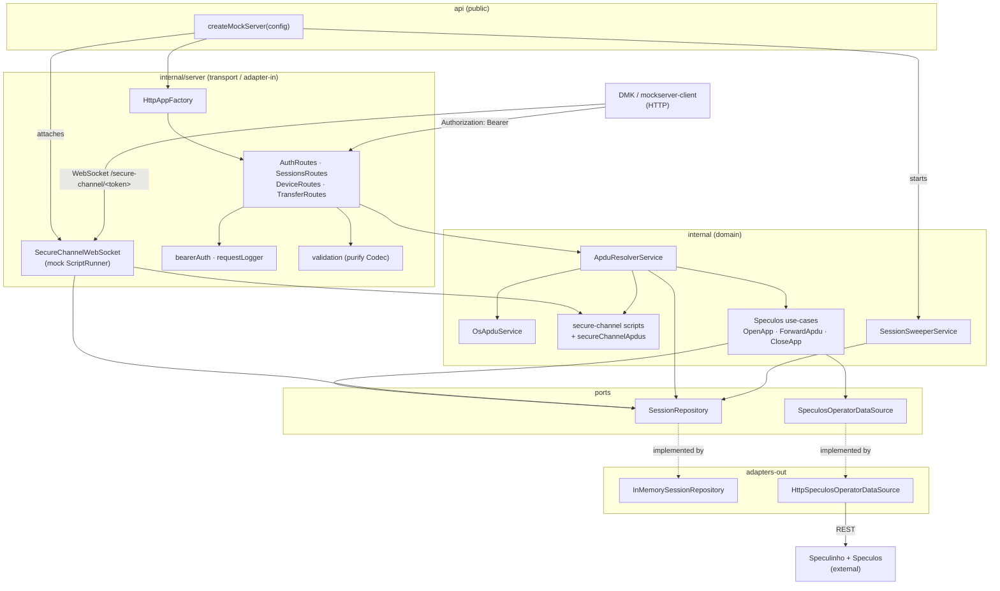
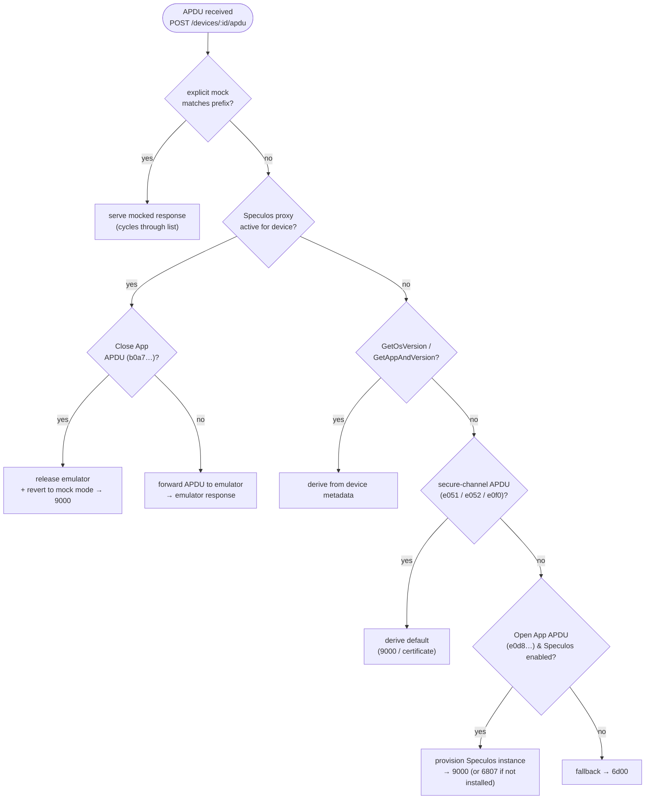
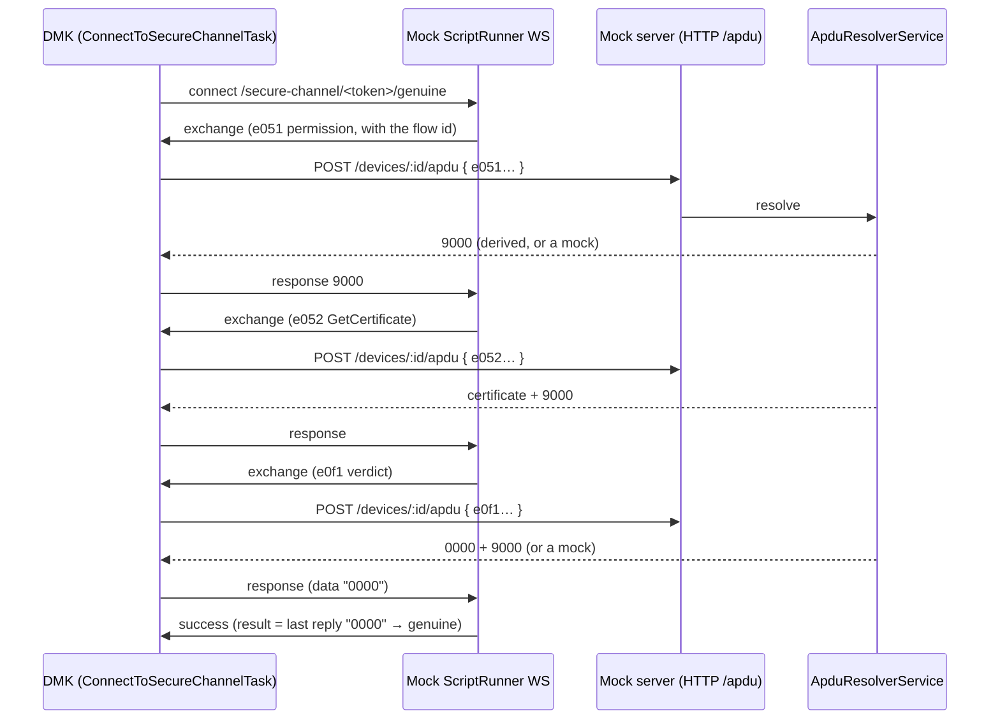
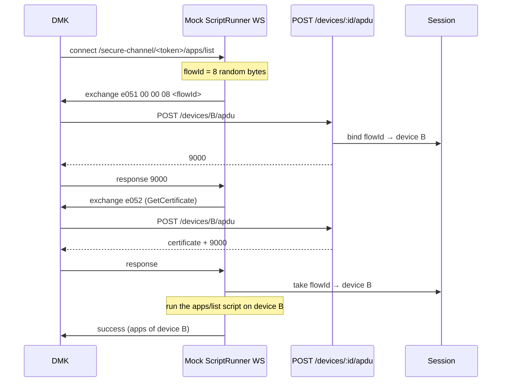
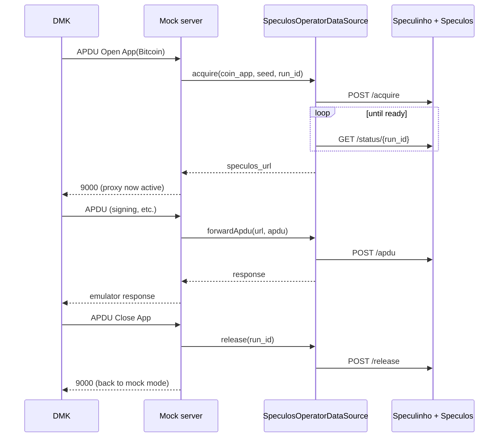

# Device Mock Server: architecture

This document is for people who work on the mock server itself. To use the server from an app or a test, read the [README](../README.md).

## 🔹 Index

1. [Architecture](#-architecture)
   - [Component graph](#component-graph)
   - [Layers](#layers)
2. [APDU resolution](#-apdu-resolution)
3. [Secure channel WebSocket](#-secure-channel-websocket)
4. [Speculos integration](#-speculos-integration)
5. [Web UI](#-web-ui)
6. [Development](#-development)
7. [Testing](#-testing)
8. [OpenAPI](#-openapi)

## 🔹 Architecture

The server follows the monorepo's hexagonal philosophy: a public `api/` surface, a private `internal/` implementation split into feature modules, dependencies wired through an [InversifyJS](https://inversify.io/) container, and `purify-ts` `Either`/`Maybe` for typed error handling. Ports (interfaces) live next to their feature; adapters implement them.

Everything is held **in memory**: there is no database. Sessions expire on a sliding inactivity TTL (30 minutes by default) and a hard lifetime cap (4 hours by default). A background sweeper disposes expired sessions and releases any Speculos instances they held.

### Component graph



### Layers

| Layer                      | Location                                                           | Responsibility                                                                                                                                                                                                                                                                                           |
| -------------------------- | ------------------------------------------------------------------ | -------------------------------------------------------------------------------------------------------------------------------------------------------------------------------------------------------------------------------------------------------------------------------------------------------- |
| **Public API**             | `src/api`                                                          | `createMockServer(config)` (composition root) + `MockServerConfig`/`MockServerApp` types. The only thing exported from the package.                                                                                                                                                                      |
| **DI**                     | `src/internal/di`                                                  | Builds the Inversify container, loading each feature's module factory.                                                                                                                                                                                                                                   |
| **Transport (adapter-in)** | `src/internal/server`, `src/internal/secure-channel`               | `HttpAppFactory` composes the Express app; the four injectable `*Routes` classes mount the endpoints; `bearerAuth`/`requestLogger` middleware; request DTOs validated with `purify` `Codec`. `SecureChannelWebSocket` attaches the mock ScriptRunner WebSocket to the same HTTP server.                  |
| **Domain**                 | `src/internal/apdu`, `os`, `secure-channel`, `speculos`, `session` | `ApduResolverService` orchestrates resolution; `OsApduService` synthesizes the handshake; the secure-channel `scripts`/`secureChannelApdus` define the relayed APDU choreography and defaults; Speculos use-cases (`OpenApp`/`ForwardApdu`/`CloseApp`); `SessionSweeperService` evicts expired sessions. |
| **Ports**                  | `*/data/*.ts`, `session/data/SessionRepository.ts`                 | Interfaces the domain depends on: `SessionRepository`, `SpeculosOperatorDataSource`.                                                                                                                                                                                                                     |
| **Adapters (adapter-out)** | `InMemorySessionRepository`, `HttpSpeculosOperatorDataSource`      | Concrete implementations of the ports.                                                                                                                                                                                                                                                                   |

### `createMockServer` options

`createMockServer(config)` accepts a `MockServerConfig`. The standalone server ([`src/main.ts`](../src/main.ts)) builds it from the environment variables listed in the [README](../README.md#run-it-locally).

| Option            | Description                                                                                                                       |
| ----------------- | --------------------------------------------------------------------------------------------------------------------------------- |
| `ttlMs`           | Sliding inactivity timeout (refreshed on each authed request).                                                                    |
| `maxLifetimeMs`   | Hard cap on session lifetime regardless of activity.                                                                              |
| `sweepIntervalMs` | Expired-session sweep interval; `0` disables the sweeper.                                                                         |
| `speculos`        | `{ baseUrl, speculosVersion?, readyTimeoutMs?, pollIntervalMs?, routeTimeoutSeconds? }`. When omitted, the server is a pure mock. |
| `webUiDir`        | Directory holding the built [web UI](#-web-ui). When omitted, the server exposes the HTTP API only.                               |

`attachWebSocket(server)` wires the [secure-channel WebSocket](#-secure-channel-websocket) onto the HTTP server's `upgrade` event.

## 🔹 APDU resolution

`ApduResolverService.resolve()` applies a fixed precedence for every incoming APDU:



1. **Explicit per-device mock**: a prefix match always wins, **even while a Speculos proxy is active** (multi-response mocks cycle). When several mocks match, the longest prefix wins, then the most recent one ([`matcher.ts`](../src/internal/apdu/service/matcher.ts)). This lets a test override a single app response mid-session, for example mock `GetAppAndVersion` to `5515` to simulate a locked device while the app runs on the emulator.
2. **Active Speculos proxy**: once an app is open, unmatched APDUs are forwarded to the emulator; `Close App` releases it and reverts to mock mode.
3. **Derived handshake and secure-channel APDUs**: `GetOsVersion` / `GetAppAndVersion` are synthesized from the device's firmware/app metadata, and the [secure-channel](#-secure-channel-websocket) relayed APDUs (`e051` permission, `e052` GetCertificate, `e0f0` install block) derive to sensible defaults (`9000` / a parseable certificate). None of these need mocking, but a mock overrides them: that is how secure-channel error paths are injected. `SetDeviceName` (`e0d4…`) writes back: it renames the device, so `GetDeviceName`, `GET /devices` and the export all report the new name. Language packs work the same way: `ListLanguagePack` (`e034…`) reports the device's `language`, installing one (the `e030`/`e031`/`e032` load script) sets it (resolved from the byte size the script announces, since it names no language), and `DeleteLanguagePack` (`e033…`) clears it. `GetOsVersion` reports the matching `langId`.
4. **Unmatched Open App**: when Speculos is configured, provisions a real emulator for the requested app (`6807` if the app is not installed on the device).
5. **Fallback**: `6d00`.

## 🔹 Secure channel WebSocket

Several DMK device actions (genuine check, list/install/uninstall apps, firmware update, and anything composing `GetDeviceMetadata({ useSecureChannel: true })`) do not talk to the device directly. They open a **WebSocket to Ledger's ScriptRunner backend**, which (driven by the HSM) streams APDUs for DMK to relay to the device and ships the responses back. DMK itself does no crypto; it is a pure relay (`ConnectToSecureChannelTask`).

The mock server ships a **mock ScriptRunner** so these flows run fully offline. It attaches a WebSocket server to the same HTTP server ([`SecureChannelWebSocket.ts`](../src/internal/secure-channel/ws/SecureChannelWebSocket.ts)) and speaks the DMK secure-channel envelope (`exchange` / `bulk` / `success` / `error`).

Because the secure-channel WebSocket carries **no bearer header**, the session token is embedded in the path: `ws://<host>/secure-channel/<token>/<endpoint>`, where `<endpoint>` is one of `genuine`, `apps/list`, `install`, `mcu`. The handler resolves the session and runs the scripted choreography for that endpoint. The URL has no device id: see [Which device runs the flow](#which-device-runs-the-flow) for how the server finds it.



The WebSocket is a thin relay: it never computes a verdict. A terminal `success` simply forwards the **last relayed APDU's reply** as its `result` (so the genuine verdict is just the resolved `e0f1` response), or sends an explicit structured `data` payload for `listApps`.

### Which device runs the flow

**Problem:** a session can hold several devices, but the WebSocket URL (`/secure-channel/<token>/<endpoint>`) has no device id. From the URL alone, the server cannot tell which device the client uses.

**Solution:** the server gets the device from the permission APDU, the first APDU of every flow:

1. The server generates a random 8-byte **flow id** and puts it in the permission APDU data: `e051 00 00 08 <flow id>`.
2. DMK sends that APDU to its device with `POST /devices/:id/apdu`. This URL has the device id, so the server records `flow id → device id`.
3. After the handshake, the server reads that record and runs the rest of the script on that device.

Each flow has its own flow id. APDUs sent to other devices, and flows running on other devices at the same time, have no effect on it.



### Default scripts

Each endpoint runs a minimal **handshake** (permission `e051` with the flow id, then GetCertificate `e052`) followed by a terminal message ([`scripts.ts`](../src/internal/secure-channel/service/scripts.ts)):

| Endpoint   | Path        | After handshake                                                                          |
| ---------- | ----------- | ---------------------------------------------------------------------------------------- |
| `genuine`  | `genuine`   | relay the `e0f1` verdict APDU, then `success` forwarding its reply (`"0000"` → genuine). |
| `listApps` | `apps/list` | `success` with the installed apps derived from metadata.                                 |
| `install`  | `install`   | `bulk` stream of synthetic install APDUs (`e0f0…`).                                      |
| `mcu`      | `mcu`       | bare `success`.                                                                          |

The relayed APDUs and their default responses live in a single source of truth, [`secureChannelApdus.ts`](../src/internal/secure-channel/service/secureChannelApdus.ts) (consumed by both `scripts.ts` and the resolver). By default they all derive to success, so a device passes without any seeded mocks.

The `install` endpoint backs app install, app uninstall and firmware install. For an app, the server resolves the request's `hash` before the handshake, from the session's `catalog` first and the Manager API second ([`InstallAppResolver.ts`](../src/internal/secure-channel/service/InstallAppResolver.ts)). For a firmware, it resolves the target version after the handshake ([`FirmwareUpdateResolver.ts`](../src/internal/secure-channel/service/FirmwareUpdateResolver.ts)). In both cases the change is armed before the bulk and applied when the last install block is acknowledged, so a follow-up `apps/list` or `GetOsVersion` reports it.

The error cases that tests inject with mocks are listed in the [README](../README.md#common-error-cases). They work because the relayed APDUs resolve through the normal [APDU precedence](#-apdu-resolution): DMK maps the non-`9000` status to the matching error and ends the operation, and the mock ScriptRunner stops the script when the client reports the error.

## 🔹 Speculos integration

When `config.speculos` is set, opening an app provisions a live emulator through [Speculinho](https://ledgerhq.atlassian.net/wiki/spaces/PE/pages/7100399635) and proxies APDUs to it. The raw passthrough (`/devices/:id/speculos/*`) goes through the `SpeculosOperatorDataSource` port: there is no `fetch` in the routes.



> The `coin_app` sent to Speculinho must be the verbatim BOLOS app name (e.g. `Ethereum`, not `eth`).

An app can also be quit from the device screen itself, which exits Speculos with it: no Close App APDU is ever sent. The emulator behind the proxy is then probed whenever a forwarded APDU or a passthrough request comes back unusable, and when it turns out to be gone the app is closed on the device's behalf: the run is released, the APDU is answered in mock mode (`GetAppAndVersion` reports `BOLOS`) and the passthrough answers `409`, exactly as for a device that never opened an app.

## 🔹 Web UI

The server hands out [`@ledgerhq/device-mock-server-ui`](../../device-mock-server-ui) at its **root URL**. The UI talks to the same HTTP API as any other client, so nothing in it is exclusive to the UI.

The UI is a static bundle, built as part of `serve`, `dev` and the workspace `build`. The server serves whatever bundle it finds and exposes the API alone if there is none. `MOCK_SERVER_WEB_DIR` points the server at a specific bundle; otherwise it looks at `./public` (where the Docker image puts it), `./apps/device-mock-server-ui/dist` and `../device-mock-server-ui/dist`, in that order.

To work on the UI itself, run its dev server instead. It proxies the API routes to a mock server on `9752`, so both sides reload independently:

```bash
pnpm --filter @ledgerhq/device-mock-server-ui dev   # http://127.0.0.1:9753
```

## 🔹 Development

Install dependencies from the **monorepo root** (`pnpm install`), then from `apps/device-mock-server/`:

```bash
pnpm dev          # tsx watch src/main.ts
pnpm serve        # run once without watching
pnpm build        # compile to lib/
pnpm start        # node lib/cjs/main.js
```

The Docker image is built from the full workspace, so the **build context must be the monorepo root**. `docker compose` (run from `apps/device-mock-server/`) sets it. For a standalone build:

```bash
# From the monorepo root:
docker build -f apps/device-mock-server/Dockerfile -t device-mock-server .
docker run --rm -p 9752:9752 -e SPECULINHO_URL= device-mock-server
```

The image bundles the web UI into `/app/public`, exposes port `9752` and has a built-in health check on `/health`.

## 🔹 Testing

```bash
pnpm test            # vitest run
pnpm test:watch
pnpm test:coverage
```

The suite mixes focused unit tests (resolver, repository, codecs, Speculos use-cases, sweeper, auth middleware, secure-channel scripts/derived APDUs) with HTTP-contract integration tests that drive the fully-assembled server over a loopback socket, including a Speculos lifecycle test with `fetch` mocked in place of Speculinho, and secure-channel WebSocket tests that drive a real `ws` client through the genuine/list/install flows and their error paths. The live Speculos path and the secure-channel genuine-check flow are also covered by the Playwright e2e suite of the [sample app](../../sample/playwright).

## 🔹 OpenAPI

The spec is produced from the `@openapi` JSDoc blocks next to the route handlers:

```bash
pnpm generate:openapi   # writes openapi.yaml
```
