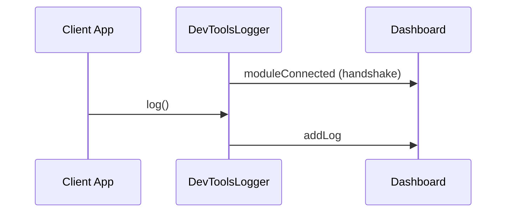
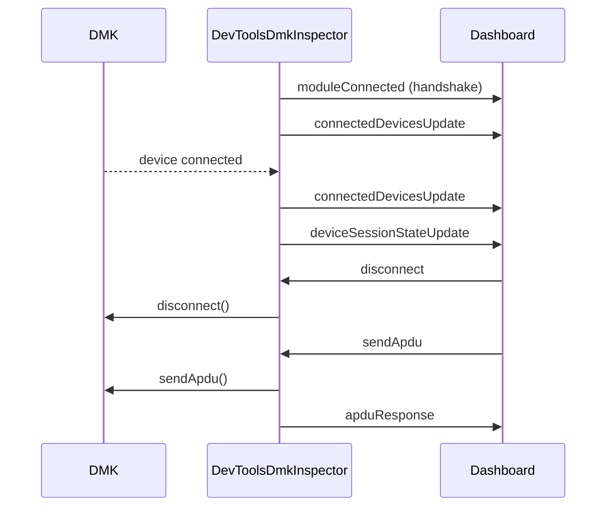
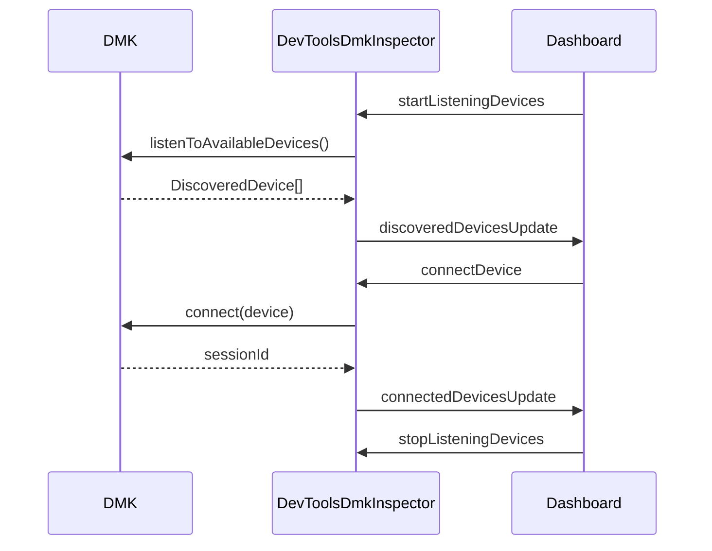

# Device Management Kit DevTools Core

Core library for DMK developer tools. Contains:

- **`DevToolsLogger`** — Relays DMK logs to the devtools dashboard
- **`DevToolsDmkInspector`** — Enables device session inspection and DMK interaction from the dashboard

## Getting Started

Choose the setup that matches your app:

- **Web, Node.js, Electron or React Native app** → [WebSocket devtools setup](../../device-management-kit/README.md#web-nodejs-or-electron-app)
- **React Native app with Rozenite** → [Rozenite devtools setup](../../device-management-kit/README.md#react-native-app-with-rozenite) _(less setup for RN, but no AI debugging: see [what each dashboard provides](#dashboard-implementations))_

## Architecture

The devtools system provides a bi-directional communication bridge between a client app (hosting the DMK) and a "Dashboard" app where the developer tools UI is displayed.

```
Client App                    Dashboard
┌──────────────────┐         ┌──────────────────┐
│  DevToolsLogger  │────────▶│  Logger Screen   │
│                  │         │                  │
│ DevToolsDmkInspector ◀────▶│ Inspector Screen │
└──────────────────┘         └──────────────────┘
        │                            │
        └───────── Connector ────────┘
            (WebSocket/Rozenite)
```

When the app uses the mock server transport, the dashboard also calls the mock server directly over HTTP, outside the Connector, to show the mock device's live screen. `DevToolsDmkInspector` only shares the mock server's URL and session token (see [Mock server](#mock-server)).


### Packages

| Package                        | Description                                                                                      |
| ------------------------------ | ------------------------------------------------------------------------------------------------ |
| `devtools-core`                | Core types, `DevToolsLogger` for logging, and `DevToolsDmkInspector` for session/DMK interaction |
| `devtools-ui`                  | React component for the devtools dashboard UI                                                    |
| `devtools-rozenite`            | Connector for React Native apps using [Rozenite](https://www.rozenite.dev/)                      |
| `devtools-websocket-common`    | Common types and constants for the WebSocket layer                                               |
| `devtools-websocket-connector` | WebSocket connector implementation for client apps                                               |
| `devtools-websocket-server`    | Node WebSocket server that relays messages between client and dashboard                          |

### Dashboard Implementations

There are two dashboard implementations:

- **Electron** (any app, through the WebSocket connector): a standalone desktop app (`apps/devtools`)
- **Rozenite** (React Native apps): the devtools appear directly in the React Native DevTools

They show the same `devtools-ui` dashboard, but not everything the host must provide is available in both:

| Feature                 | Electron                                             | Rozenite          |
| ----------------------- | ---------------------------------------------------- | ----------------- |
| Logger and Inspector    | Yes                                                  | Yes               |
| Mock device live screen | Yes, through a `mockserver://` proxy that asks first | Yes, direct calls |
| AI debugging            | Yes, with the computer's Claude Code login           | Not yet           |

AI debugging runs Claude Code in the Electron main process, which Rozenite cannot host. In Rozenite the AI buttons are disabled. A React Native app can still use AI debugging by connecting to the desktop app with the [WebSocket setup](../../device-management-kit/README.md#web-nodejs-or-electron-app).

### Module Architecture

#### Connector Interface

Both `DevToolsLogger` and `DevToolsDmkInspector` communicate with the dashboard through a `Connector` interface:

```ts
interface Connector {
  sendMessage: (type: string, payload: string) => void;
  listenToMessages: (listener: (type: string, payload: string) => void) => {
    unsubscribe: () => void;
  };
}
```

This interface is implemented by:

- `DevToolsWebSocketConnector` — for web, Node.js, Electron, and React Native apps
- `RozeniteConnector` — for React Native apps using Rozenite

#### Module Handshake

When a module is instantiated, it sends a `moduleConnected` message to identify itself to the dashboard. This allows the dashboard UI to show connection status for each module and conditionally render UI elements.

This mechanism helps developers integrating the tools verify that their setup is working as expected. For instance, if someone only sets up `DevToolsLogger` or only `DevToolsDmkInspector` (which is allowed, but could be a user mistake), the Dashboard UI will reflect it with visual indicators.

#### DevToolsLogger Protocol

`DevToolsLogger` provides **one-way communication** from the client app to the dashboard for log streaming.



| Direction          | Message Type      | Payload                                                                |
| ------------------ | ----------------- | ---------------------------------------------------------------------- |
| Client → Dashboard | `moduleConnected` | `{ module: "logger" }`                                                 |
| Client → Dashboard | `addLog`          | `DevToolsLog` object (timestamp, tag, verbosity, message, payloadJSON) |

#### DevToolsDmkInspector Protocol

`DevToolsDmkInspector` provides **bi-directional communication** for device session inspection and DMK interaction.

**Session inspection flow:**



**Device discovery flow:**



**Messages from Inspector to Dashboard:**

| Message Type               | Payload                                              | Description                              |
| -------------------------- | ---------------------------------------------------- | ---------------------------------------- |
| `moduleConnected`          | `{ module: "dmk-inspector" }`                        | Handshake                                |
| `connectedDevicesUpdate`   | `ConnectedDevice[]`                                  | List of all connected devices            |
| `deviceSessionStateUpdate` | `{ sessionId, state }`                               | Session state change                     |
| `mockServerConfig`         | `{ url, sessionToken? }` or `null`                   | The app's mock server, sent on handshake |
| `providerValue`            | `{ provider: number }`                               | Response to getProvider                  |
| `apduResponse`             | `{ requestId, success, statusCode?, data?, error? }` | Response to sendApdu                     |
| `discoveredDevicesUpdate`  | `DiscoveredDevice[]`                                 | List of available devices for connection |

**Commands from Dashboard to Inspector:**

| Command Type            | Payload                          | Description                                         |
| ----------------------- | -------------------------------- | --------------------------------------------------- |
| `disconnect`            | `{ sessionId }`                  | Disconnect a device session                         |
| `sendApdu`              | `{ sessionId, apdu, requestId }` | Send raw APDU to device                             |
| `getProvider`           | —                                | Request current provider value                      |
| `setProvider`           | `{ provider: number }`           | Set provider value                                  |
| `startListeningDevices` | —                                | Start listening for available devices (passive)     |
| `stopListeningDevices`  | —                                | Stop listening for available devices                |
| `startDiscovering`      | —                                | Start active discovery (triggers permission prompt) |
| `stopDiscovering`       | —                                | Stop active discovery                               |
| `connectDevice`         | `{ deviceId }`                   | Connect to a discovered device                      |

#### Lifecycle

- **`DevToolsLogger`** — Instantiated _before_ DMK is built, then passed to `DeviceManagementKitBuilder.addLogger()`
- **`DevToolsDmkInspector`** — Instantiated _after_ DMK is built, requires the DMK instance. An optional third argument `{ mockServer: { url, sessionToken? } }` shares the app's mock server with the dashboard
- Both modules should share the same `Connector` instance
- Call `DevToolsDmkInspector.destroy()` to clean up subscriptions when done

### Mock server

When the app uses the [device mock server](../../../apps/device-mock-server) transport, pass it to the inspector:

```ts
const inspector = new DevToolsDmkInspector(connector, dmk, {
  mockServer: { url: "http://127.0.0.1:9752", sessionToken },
});
```

The inspector sends it in a `mockServerConfig` message (or `null` without one, so the dashboard forgets a previous app's mock server). The dashboard then calls the mock server itself, outside the Connector:

- The Inspector shows the mock device's live screen.
- A navigation-bar button opens the mock server website on the app's session. It only appears for an `http(s)` URL with a session token.

The app chooses the URL, so the Electron dashboard proxies these calls through `mockserver://`, asks before contacting a new origin and never follows a redirect.

### Features

#### DevToolsLogger

- [x] **Real-time log display** — View all DMK logs in real-time with verbosity levels and tags
- [x] **Filtering** — Filter logs by level and tag, and by text (Ctrl/Cmd+K)
- [x] **Search** — Find text in the logs (Ctrl/Cmd+F) and step through the matches
- [x] **Payloads** — Preview each payload and expand it into a tree
- [x] **Large sessions** — Keeps the newest 20,000 logs, pause and clear
- [x] **Export** — Export logs to JSON

#### DevToolsDmkInspector

- [x] **Device sessions inspector** — Display all connected device sessions and their live states
  - List all active device sessions with device info (model, name, connection type)
  - Show live `DeviceSessionState` for each session (status, battery, current app, OS info)
- [x] **APDU list** — Every APDU exchanged with the selected session, with filter, pause, clear and export
  - Each APDU is named after the command of the app open when it was sent (`getAppAndVersion`, `signPsbt`…) and tagged with the OS or app that answered
  - The list is built from DMK's logs, so it needs `DevToolsLogger` on the same Connector
- [x] **Device session actions** — Interact with device sessions from the dashboard
  - Disconnect a device session
  - Send raw APDU commands to a session
- [x] **Device discovery** — Discover and connect to devices from the dashboard
  - Start/stop device discovery (passive listening and active discovery)
  - View list of available devices
  - Connect to a discovered device
- [x] **Mock server** — The mock device's live screen and a link to the mock server website (see [Mock server](#mock-server))

The inspector still answers `getProvider` / `setProvider`, but the dashboard no longer has a control for the My Ledger API provider.

#### AI debugging (Electron only)

- [x] **Explain with AI** — Select logs or APDUs and Claude explains what happened, why, and what to try next, then answers follow-up questions
- [x] **Read the code** — When the desktop app runs from this repository, Claude can also read DMK's source
- [x] **Create Jira ticket** — When the verdict is a bug, file it in `DSDK` through the user's Atlassian connector

See the [desktop app README](../../../apps/devtools/README.md#ai-debugging) for what it needs.
